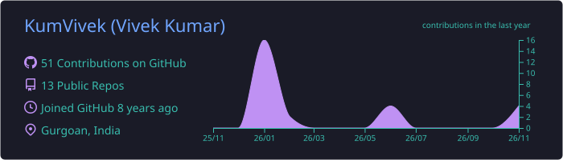

<div align="center">


<br />

<a href="https://www.linkedin.com/in/vivek-kumar-b7482777/"></a>
<a href="https://www.nuget.org/profiles/KrVivek"></a>
<a href="https://marketplace.visualstudio.com/items?itemName=KumVivek.copilot-usage-monitor"></a>
<a href="https://github.com/KumVivek?tab=repositories"></a>
<a href="https://github.com/KumVivek"></a>
<a href="https://github.com/KumVivek?tab=followers"></a>

</div>

## About me

<table>
<tr>
<td width="58%">

```csharp
public sealed class VivekKumar : Engineer
{
    public string Role => "Staff Engineer";
    public string Company => "Nagarro";
    public string Location => "Gurgaon, India";

    public string[] Stack =>
    [
        "C#", ".NET", "ASP.NET Core",
        "gRPC", "Docker", "Kubernetes",
        "React", "Python"
    ];

    public string[] Exploring =>
    [
        "Agentic AI",
        "Copilot guardrails"
    ];
}
```

</td>
<td width="42%" align="center">

</td>
</tr>
</table>

## Tech stack

<details open>
<summary><b>Languages and frameworks</b></summary>
<br />


</details>

<details>
<summary><b>Cloud and DevOps</b></summary>
<br />


</details>

<details>
<summary><b>Data</b></summary>
<br />


</details>

<details>
<summary><b>Tools and AI</b></summary>
<br />


</details>

## Published

| Package | What it does | Where |
| :--- | :--- | :--- |
| [Copilot Usage Monitor](https://marketplace.visualstudio.com/items?itemName=KumVivek.copilot-usage-monitor) | Tracks AI-assisted vs manual code edit ratios for GitHub Copilot | [VS Code Marketplace](https://marketplace.visualstudio.com/items?itemName=KumVivek.copilot-usage-monitor) |
| [SharpInstaMojo](https://www.nuget.org/packages/SharpInstaMojo) | .NET Core wrapper for the Instamojo API | <a href="https://www.nuget.org/packages/SharpInstaMojo"></a> |
| [Changelly](https://www.nuget.org/packages/Changelly) | .NET wrapper for the Changelly API | <a href="https://www.nuget.org/packages/Changelly"></a> |

## Featured projects

<table>
<tr>
<td><a href="https://github.com/KumVivek/copilot-instruction-agent"></a></td>
<td><a href="https://github.com/KumVivek/copilot-instruction-driven"></a></td>
</tr>
<tr>
<td><a href="https://github.com/KumVivek/gRPC"></a></td>
<td><a href="https://github.com/KumVivek/InstaSharp"></a></td>
</tr>
</table>

<details>
<summary><b>More work over the years</b></summary>
<br />

| Year | Project | What it is |
| :--- | :--- | :--- |
| 2026 | [kubernetes-assignment](https://github.com/KumVivek/kubernetes-assignment) | Two-tier Kubernetes deployment of an ASP.NET Core API and Postgres |
| 2026 | [copilot-instruction-agent](https://github.com/KumVivek/copilot-instruction-agent) | RepoSentinel, a Python engine that generates Copilot guardrails |
| 2026 | [copilot-instruction-driven](https://github.com/KumVivek/copilot-instruction-driven) | ASP.NET Core demo steered by Copilot instructions |
| 2025 | [github-pages-poc](https://github.com/KumVivek/github-pages-poc) | C# proof of concept with a GitHub Actions workflow |
| 2024 | [theme-react](https://github.com/KumVivek/theme-react) | React app |
| 2022 | [NAGP-devops](https://github.com/KumVivek/NAGP-devops) | .NET app with Docker and a Jenkins pipeline |
| 2021 | [gRPC](https://github.com/KumVivek/gRPC) | Unary and server-streaming gRPC samples in .NET |
| 2018 | [InstaSharp](https://github.com/KumVivek/InstaSharp) | .NET Core wrapper for the Instamojo API |
| 2018 | [SharpChangelly](https://github.com/KumVivek/SharpChangelly) | C# wrapper for the Changelly API |
| 2018 | [Smart_Contract](https://github.com/KumVivek/Smart_Contract) | Ethereum smart contracts in Solidity |

</details>

## GitHub activity

<div align="center">







<br /><br />

<picture>
  <source media="(prefers-color-scheme: dark)" srcset="https://raw.githubusercontent.com/KumVivek/KumVivek/output/snake-dark.svg" />
  <source media="(prefers-color-scheme: light)" srcset="https://raw.githubusercontent.com/KumVivek/KumVivek/output/snake.svg" />
  
</picture>

</div>


